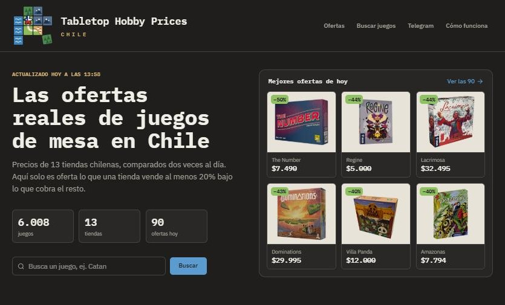
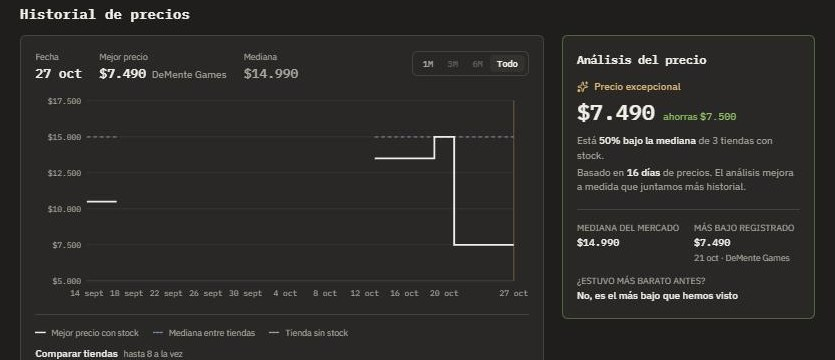

# Tabletop Hobby Prices Chile

[](https://github.com/SimonVC89/tabletop-hobby-prices-chile/actions/workflows/ci-scraper.yml)
[](https://github.com/SimonVC89/tabletop-hobby-prices-chile/actions/workflows/ci-backend.yml)
[](https://github.com/SimonVC89/tabletop-hobby-prices-chile/actions/workflows/ci-frontend.yml)
[](LICENSE)

Monitoreo de precios de juegos de mesa en tiendas chilenas online. El objetivo
es detectar ofertas reales por **asimetría de información** entre tiendas
(una tienda que no actualiza su precio según la referencia real de mercado),
no errores de tipeo puntuales.

**Sitio:** https://thpc.vercel.app · **API (documentación y pruebas con Swagger):** https://thpc-api.onrender.com/swagger-ui.html



## Motivación

Proyecto personal, nacido de una colección de +50 juegos de mesa y las ganas
de automatizar algo que hacía manualmente (comparar precios entre tiendas
antes de comprar). Es open source para que otros aficionados al hobby en
Chile puedan revisarlo, usarlo o adaptarlo a su propio stack.

## Stack

| Capa | Tecnología |
|---|---|
| Scraping | Python (Requests + BeautifulSoup) |
| Matching de productos | Normalización determinística + embeddings (sentence-transformers, local) |
| Base de datos | Supabase (Postgres + pgvector) |
| Automatización | GitHub Actions, lanzado a la hora exacta por cron-job.org |
| Backend | Spring Boot 4 (Java 21), API REST documentada con OpenAPI, desplegado en Render (Docker) |
| Frontend | React + TypeScript + Vite + Tailwind, desplegado en Vercel |
| Alertas | Bot de Telegram (comandos por webhook a la API; resumen y avisos desde Python) |
| Pruebas y CI | pytest (scraper), JUnit (backend) y Vitest + Testing Library (frontend), en GitHub Actions por carpeta |

Todo corre en capas gratuitas — es un proyecto de uso personal, no un
servicio comercial.

## Arquitectura

```
GitHub Actions (05:17 y 19:17, lanzado por cron-job.org)
  scrapers + matching (Python) --escribe--> Supabase (Postgres + pgvector)
  resumen y avisos (Telegram)  <--lee-----/        |
                                                   | lee (rol thpc_api, mínimo privilegio)
                                                   v
                                  API REST (Spring Boot, Docker en Render)
                                         |                    ^
                                         v                    | webhook (comandos del bot)
                             frontend (React, Vercel)      Telegram
```

El scraper se conecta directo a Postgres (no vía la Data API de Supabase):
las tablas quedaron deliberadamente sin exponer por REST, así que tanto el
scraper como el backend hablan directo con la base, como dos servicios
internos — no hay superficie pública adicional que proteger. La API usa un
rol propio (`thpc_api`) que solo puede leer el catálogo y escribir en las
tablas del bot: si sus credenciales se filtraran, no servirían para
modificar ni borrar precios ni productos.

## Estructura del repositorio

| Carpeta | Contenido |
|---|---|
| `scraper/` | Scrapers por tienda, matching de productos, mantención de datos y bot (resumen y avisos), en Python |
| `backend/` | API REST en Spring Boot: catálogo, ofertas, historial y webhook del bot |
| `frontend/` | Sitio en React que consume la API |
| `supabase/` | Migraciones SQL del esquema (tablas, vistas materializadas, roles) |
| `.github/workflows/` | Corrida del scraper, CI de cada carpeta y aviso de tiendas manuales |

## Estado actual

- Esquema de datos completo: `stores`, `products`, `product_listings`,
  `price_history`, `price_alerts`, con soporte pgvector.
- 13 scrapers de tiendas chilenas funcionando: La Loseta, DeMente Games,
  UpDown, VuduGaming, Griffin Games, Aldea Juegos, Mana House, Café 2d6,
  El Patio Geek, Wargaming, Diverti, Piedra Bruja y Jugones. (PlanetaLoz
  fue parte del proyecto hasta octubre de 2026, ver "Scraping responsable".)
- Clasificación de productos: lo que las tiendas listan como "juegos de
  mesa" pero no lo es (protectores, boosters de TCG, naipes, libros de rol,
  puzzles) se clasifica aparte y queda fuera de ofertas, alertas y frontend.
  Los complementos de un juego específico (expansiones, dados o insertos
  propios) sí cuentan como juego de mesa.
- Pipeline de matching: clave determinística (`match_key`) como mecanismo
  principal, embeddings (Hugging Face / sentence-transformers) como capa
  secundaria (hoy alimentan "juegos similares"). El nombre visible de cada
  producto se elige por votación entre tiendas (el título que más tiendas
  escriben igual, limpio de sufijos como " - Español").
- ~2.800 juegos de mesa comprables hoy, ~1.000 comparables en 2+ tiendas
  (con stock) y ~550 con mediana confiable (3+ tiendas). Cada producto tiene imagen y descripción corta, extraídas del
  propio HTML scrapeado (sin depender de ninguna API externa).
- Dos corridas diarias en GitHub Actions (05:17 y 19:17, justo después del
  horario laboral) para 12 de las 13 tiendas; UpDown queda solo para corrida
  manual, ver "Scraping responsable". Las lanza cron-job.org a la hora exacta
  vía la API de GitHub: el `schedule` propio de GitHub las arrancaba con 3 a 7
  horas de atraso. El historial de precios guarda solo cambios.
- Bot de Telegram (`/start`, `/stop`, `/seguir`, `/siguiendo`, `/dar_de_baja`,
  `/estado`, `/ayuda`): resumen de ofertas (destacadas 50%+ y regulares 20%+ bajo la
  mediana) y avisos de los juegos que cada persona sigue (bajan de precio o
  vuelven a tener stock). Los comandos llegan por webhook a la API, que responde
  en segundos (antes se leían con un workflow programado que en la práctica
  corría cada ~3 horas); el resumen y los avisos salen desde Python después de
  cada corrida del scraper.
- API REST en Spring Boot 4 (Java 21) con el mismo contrato que consume el
  frontend (`frontend/src/api/types.ts`): ofertas, bajas de precio de la
  semana, búsqueda paginada, ficha, historial diario reconstruido, juegos
  relacionados (similitud de pgvector), tiendas y estado de la última
  actualización. Publicada en Render con Docker; un ping periódico evita que el
  plan gratuito la duerma. Documentada con OpenAPI (springdoc): en
  `/swagger-ui.html` se ven todos los endpoints y se pueden probar.
- Frontend en React publicado en Vercel: Inicio, ofertas, buscador, ficha
  con gráfico de historial por tienda, página del bot y "Cómo funciona".
- Monitoreo de las corridas: una tienda que falla se reintenta a los 2 y 5
  minutos; si sigue fallando dos corridas seguidas, la corrida queda en error
  y GitHub avisa por email. Una tienda que devuelve 0 productos cuenta como
  falla (el scraper quedó obsoleto), y una cerrada al público (página de
  contraseña de Shopify) solo deja una advertencia y vuelve sola al reabrir.
- Política de retención de datos: `price_history` se poda a 8 meses, y un
  producto sin ningún listing activo hace 6+ meses se oculta (soft-delete,
  reversible si vuelve a aparecer).
- Alcance actual: solo juegos de mesa modernos. El soporte para Magic: The
  Gathering (singles y producto sellado) está diseñado en el esquema pero
  pausado por ahora.



## Decisiones técnicas

- **Oferta = bajo la mediana, no un porcentaje de descuento publicado.** Las
  tiendas inflan el "precio normal"; la referencia es la mediana de lo que
  cobran las demás (un precio por tienda, mínimo 3 tiendas). La mediana y no
  el promedio, para que una tienda carísima no haga parecer oferta a las demás.
- **Matching en dos capas.** Primero una clave determinística (`match_key`,
  título normalizado), que es predecible y fácil de depurar; los embeddings
  quedan como capa secundaria para lo que la clave no resuelve.
- **El historial guarda solo cambios.** Dos corridas diarias sin duplicar la
  base: `price_history` agrega una fila solo si cambió el precio o el stock, y
  la API reconstruye la serie diaria.
- **Mínimo privilegio.** El scraper escribe; la API usa un rol que solo lee el
  catálogo y escribe únicamente las tablas del bot.
- **Webhook en vez de polling.** Los comandos del bot llegan a la API y se
  responden en segundos; antes se leían desde un workflow programado.
- **Horario exacto con cron-job.org.** El `schedule` de GitHub Actions
  arrancaba con horas de atraso; un servicio externo lanza el workflow por la
  API de GitHub con un token limitado a este repositorio.
- **No esquivar bloqueos.** Una tienda que bloquea el acceso automatizado se
  deja fuera o se actualiza a mano (ver "Scraping responsable").

## Cómo correrlo en local

**Solo el frontend (sin backend ni base de datos).** Usa una muestra de 60
juegos grabada desde la API real (`frontend/public/mock-sample/`):

```bash
cd frontend
npm ci
npm run dev        # http://localhost:5173
npm test           # pruebas (Vitest)
```

**Todo el proyecto.** Requiere un proyecto de Supabase (Postgres con
pgvector) con las migraciones de `supabase/migrations/` aplicadas
(`supabase db push`, o pegarlas en orden en el editor SQL).

```bash
# Scraper (Python 3.13)
cd scraper
pip install -r requirements.txt
cp .env.example .env              # DATABASE_URL (y TELEGRAM_BOT_TOKEN para el bot)
python -m src.ingest_laloseta     # una tienda; el orden completo está en .github/workflows/scraper.yml
python -m pytest -q

# Backend (Java 21 + Maven)
cd backend
cp .env.example .env              # DB_URL, DB_USER, DB_PASSWORD (idealmente el rol thpc_api)
mvn spring-boot:run               # http://localhost:8080/swagger-ui.html
mvn verify                        # pruebas

# Frontend contra el backend local
cd frontend
npm run dev:api
```

## Roadmap

- [x] Imagen Docker del backend (con CDS para arrancar rápido en el plan gratuito)
- [ ] `docker-compose` para levantar todo en local
- [x] Tests (`pytest` para el scraper/matching, JUnit para el backend, Vitest para el frontend)
- [ ] Logging estructurado (reemplazar `print()`)
- [ ] Validación de datos con Pydantic en el scraper
- [x] Reintentos con backoff exponencial en requests HTTP
- [x] CI/CD con GitHub Actions: cron diario de scraping + matching
- [x] Vistas materializadas (`current_prices`, `product_price_stats`) con
      precio de referencia por mediana entre tiendas, refrescadas en cada
      corrida del cron
- [x] Bot de Telegram con resumen de ofertas después de cada corrida,
      suscripción abierta y seguimiento de juegos
- [x] Webhook de Telegram en el backend, para que el bot responda en segundos
- [x] Política de retención: poda de `price_history` (8 meses) y soft-delete
      de productos descontinuados (6 meses sin listings activos)
- [x] CI por carpeta para `scraper/`, `backend/` y `frontend/` en cada push y PR: pytest, JUnit + build del backend, lint + Vitest + build del frontend
- [x] Backend: API REST con DTOs, paginación y caché del catálogo
- [x] Documentación OpenAPI/Swagger de la API
- [x] Frontend con gráficos de precio histórico (Recharts)
- [ ] Sub-categorización de juegos de mesa (familiar/estrategia/party, etc.) —
      cada tienda usa su propia taxonomía, sin estándar compartido entre ellas
- [ ] Reactivar MTG (singles vía Scryfall, sellado vía matching propio)

## Scraping responsable

- Delay de 1.5s entre requests a la misma tienda.
- Las tiendas con protección activa anti-bot (Cloudflare, etc.) se excluyen
  deliberadamente en vez de intentar evadir la protección.
- **UpDown no corre en el cron automático**: devuelve 403 Forbidden
  específicamente desde las IPs de los runners de GitHub Actions (bloqueo a
  tráfico de datacenter), aunque funciona sin problema corrida manualmente
  desde una red residencial. Por la misma razón de arriba, no se intenta
  sortear ese bloqueo — su script de ingesta sigue disponible para correr
  en local. **Efecto secundario conocido**: como la política de retención
  marca un listing inactivo si no se ve en 3+ días, sus precios quedan
  afuera de la comparación poco después de cada corrida manual, y un
  producto exclusivo de UpDown podría ocultarse como "descontinuado" a los
  6 meses sin corrida — no porque haya desaparecido, sino por falta de
  monitoreo. Correrla manualmente cada tanto evita esto (el bot avisa al
  mantenedor por Telegram 24, 12 y 2 horas antes del plazo); se aceptó el
  riesgo en vez de agregar un umbral de retención distinto por tienda.
- **La Loseta falla a ratos desde GitHub**: en algunas corridas su servidor no
  responde a la IP del runner (desde una conexión normal funciona). Tampoco
  se esquiva: una corrida perdida no cambia nada visible, y si falla dos
  corridas seguidas, el aviso de error permite actualizarla a mano.
- **PlanetaLoz fue excluida (octubre de 2026)**: empezó a bloquear todo
  acceso automatizado (403 incluso desde una conexión residencial, mientras
  que un navegador normal entra sin problema). Se respetó el bloqueo: se
  eliminó su scraper, la tienda quedó marcada inactiva y su historial de
  precios hasta septiembre se conserva. Si la tienda lo autoriza, el código
  sigue disponible en el historial de git.
- Uso estrictamente personal y no comercial.

## Autor

Simón Villar · [LinkedIn](https://www.linkedin.com/in/simonvillarcabrera) · [GitHub](https://github.com/SimonVC89)

## Licencia

MIT — ver [LICENSE](LICENSE).
